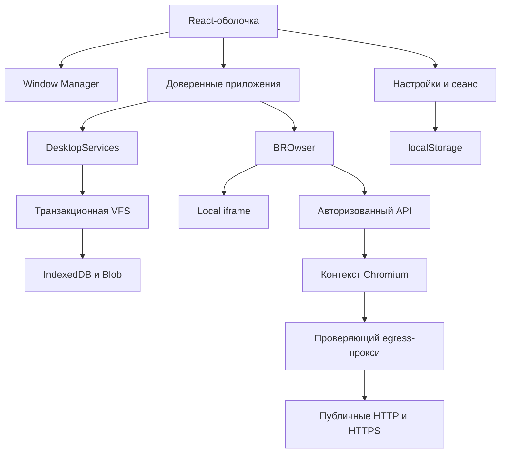

# Архитектура BROwOS

BROwOS 0.1.0 объединяет браузерную оболочку, общие службы, системные приложения и
необязательный сервер Chromium. Архитектура ниже описывает существующие модули.
Она не подразумевает наличие Windows kernel, POSIX-процессов или виртуальной машины.

## Границы исполнения

В Local весь рабочий стол исполняется в одном frontend-приложении React. Каждое
окно содержит доверенный компонент из репозитория. Файловые операции обращаются к
IndexedDB текущего origin. Для этой работы не нужен backend.

В Connected тот же frontend отправляет авторизованные команды отдельному
серверу. На сервере живёт Chromium, а клиент получает изображение страницы.
Локальная VFS при подключении не переносится на сервер и не синхронизируется с ним.

## Исходники и зависимости

| Модуль                         | Ответственность                                                                           | Основные потребители           |
| ------------------------------ | ----------------------------------------------------------------------------------------- | ------------------------------ |
| `apps/web`                     | Загрузка VFS, оболочка, события пользователя, рамки окон, диалоги и маршрутизация запуска | Пользователь                   |
| `packages/window-manager`      | Чистые переходы состояния окон и валидация восстановления                                 | Оболочка и оконная рамка       |
| `packages/filesystem`          | Дерево каталогов, содержимое, транзакции, корзина и backup                                | Все файловые приложения        |
| `packages/kernel`              | Проверка и сохранение настроек, системные типы                                            | Оболочка и Параметры           |
| `packages/application-runtime` | Метаданные приложений, singleton и ассоциации файлов                                      | Пуск, панель задач, `openFile` |
| `packages/sdk`                 | Типизированный договор приложения с оболочкой                                             | Системные приложения           |
| `packages/ui`                  | Общие иконки и представление значков                                                      | Оболочка и приложения          |
| `packages/shared`              | Версия, форматирование, ошибки и нормализация веб-адресов                                 | Несколько пакетов и приложений |
| `system-apps/*`                | Конкретные редакторы, просмотрщики и инструменты                                          | Окна оболочки                  |
| `apps/server`                  | HTTP API, Chromium-сессии, сетевой фильтр и прокси                                        | Connected-клиент               |

Vite собирает исходники workspace-пакетов для frontend. Сервер компилируется
отдельным `tsconfig.json` с `NodeNext` в `apps/server/dist`; его runtime не зависит
от Vite dev-сервера. Общий lockfile закрепляет зависимости всего репозитория.

## Запуск оболочки

`OperatingSystem` в `apps/web/src/App.tsx` открывает `VirtualFileSystem`.
Первичная инициализация каталога происходит в хранилище. Пока база готовится,
пользователь видит загрузку; ошибка IndexedDB отображается как ошибка запуска с
возможностью повторить попытку.

После загрузки `Desktop` создаёт:

- подписку на ревизию VFS через `useSyncExternalStore`;
- проверенные настройки из localStorage;
- состояние окон через `windowReducer` и безопасное восстановление;
- общие сервисы запуска, файловых диалогов, заголовков и уведомлений;
- UI Пуска, панели задач, виртуальных столов и системных панелей.

При первом пустом сеансе открывается знакомство с BROwOS. `AppBoundary` ловит
ошибку рендеринга конкретного приложения. Это защита доступности интерфейса;
компоненты по-прежнему исполняются в общем JavaScript-контексте.

## Оконная система

Источник логики — [packages/window-manager/src/index.ts](packages/window-manager/src/index.ts).
`DesktopWindow` хранит ID, приложение, заголовок, геометрию, z-index, состояния
сворачивания/разворачивания, snap, исходные размеры для возврата и номер рабочего стола.

Reducer принимает явные действия: open/focus/close, bounds, minimize/maximize,
snap, смена рабочего стола, show-desktop и restore-desktop. Это позволяет отдельно
проверять фокус, порядок окон и восстановление, независимо от DOM и анимаций.
Оконная рамка преобразует pointer-события в действия и видимую геометрию.

Оболочка допускает до 30 окон и предоставляет два виртуальных стола. Развёрнутое
или закреплённое окно вычисляет видимые границы относительно доступной области
экрана. Исходные размеры сохраняются отдельно, поэтому выход из maximize/snap не
должен превращать текущую полноэкранную геометрию в постоянный размер окна.

«Показать рабочий стол» сохраняет набор скрытых им окон. Возврат восстанавливает
этот набор, сохраняя ранее свёрнутые пользователем окна. Переключение столов выбирает
подходящее видимое окно для фокуса.

Сохранённый JSON считается недоверенным вводом. Восстановление ограничивает число
окон и размеры, отклоняет неизвестные app ID и дубликаты, нормализует z-index и
фокус. Из launch data восстанавливаются только допустимые `fileId` и `folderId`.
Произвольное содержимое памяти приложения, токены и черновики не являются форматом
восстанавливаемого сеанса.

## Файловая система

Подробный API и ограничения:
[packages/filesystem/README.md](packages/filesystem/README.md).

### Модель данных

Публичный `FSNode` содержит ID, parent ID, имя, тип, MIME, размер, timestamps и
признак удаления. Внутренний `StoredNode` дополнительно удерживает Blob содержимого
и связь с корнем операции удаления. Стабильный ID сохраняется при rename/move;
copy создаёт новые ID для всего дерева.

Корень и системные каталоги `desktop`, `documents`, `downloads`, `pictures`,
`music`, `videos` защищены от удаления, переименования и перемещения. Пользователь
работает с их содержимым. Имена нормализуются и проверяются без учёта регистра;
нельзя создать конфликтующую запись, переместить папку внутрь себя или оставить
несуществующего родителя.

### Транзакции и несколько вкладок

Каждая мутация открывает read/write-транзакцию над хранилищами `nodes` и `meta`,
загружает актуальное дерево, повторно проверяет операцию и записывает данные вместе
с ревизией. In-memory snapshot обновляется и подписчики уведомляются после commit.
Quota error или иная ошибка отменяет всю операцию, включая уже поставленные в
очередь записи.

Это существенно для двух вкладок: сохранение не записывает поверх базы устаревший
снимок другого окна. `BroadcastChannel` сообщает о новой ревизии; refresh при
возвращении фокуса служит дополнительным механизмом. Синхронное чтение метаданных
может кратковременно видеть предыдущую ревизию; явный `refresh()` обновляет её.

### Конфликт редакторов

У `updateFile` есть параметр `expectedUpdatedAt`. Редактор сохраняет версию файла,
с которой начал работу, и передаёт её при обновлении. Если другой редактор успел
изменить файл, VFS возвращает `CONFLICT` вместо незаметной перезаписи.

Без этого аргумента операция использует last-writer-wins. Общий SDK
`saveFile({existingId})` не добавляет проверку версии самостоятельно. Редакторы,
которым важна защита от конфликтов, должны вызывать версионный `fs.updateFile`;
Блокнот и Paint используют такую проверку при сохранении открытого файла.

### Корзина и backup

Удаление в Корзину отмечает поддерево, сохраняя его содержимое. Отдельно удалённые
дочерние элементы не оживают вместе с родителем. Восстановление возвращает запись
в исходную папку либо в Documents, если исходное место остаётся удалённым.
Безвозвратное удаление отделено в API и подтверждается вызывающим интерфейсом.

Backup — JSON с метаданными и base64-содержимым, включая Корзину. Import проверяет
формат, связи, имена, MIME, размеры, timestamps, base64, защищённые папки и циклы
до изменения базы. Пользовательские ID переназначаются, конфликты имён получают
суффиксы, а существующие данные сохраняются. Весь импорт добавляется одной транзакцией.

В preview операции используют дерево в памяти; backup также формируется в памяти.
Импорт ограничен 20 000 записями, 256 уровнями и 140 млн символов JSON. Это выбор
для документов и умеренной медиатеки. Потоковые архивы, очень большие коллекции и
индексирование без полного чтения дерева — дальнейшая работа.

IndexedDB обеспечивает постоянство внутри браузерного профиля и origin, но не
облачную синхронизацию и не шифрование данных. Логический `getUsage()` считает
байты файлов вместе с Корзиной, а не оставшуюся квоту браузера. Оценка квоты и
запрос persistent storage выполняются отдельно в Параметрах.

## Приложения и SDK

`AppManifest` описывает ID, заголовок, иконку, цвет, начальные размеры, singleton
и расширения. Оболочка хранит соответствие app ID доверенному React-компоненту.
`appForFile` выбирает просмотрщик по MIME/расширению; `openFile` передаёт ID из VFS.

`DesktopServices` предоставляет приложениям файловую систему, её ревизию, запуск
других приложений, уведомления, заголовок окна, close guard и общие Open/Save-диалоги.
Приложение не должно создавать свою независимую файловую базу для общих документов.

Блокнот и калькулятор имеют отдельно проверяемые модели. Терминал использует
парсер аргументов и явный список команд без shell expansion, `eval` или запуска
подпроцессов. Paint работает через Canvas, Photos и Media Player создают Object
URL из Blob; их жизненный цикл должен освобождать эти URL при смене файла и закрытии.

Это SDK для доверенного исходного кода. У него нет пакетного установщика,
изолированных разрешений или безопасного выполнения произвольного стороннего
JavaScript. Как добавить встроенное приложение: [docs/SDK.md](docs/SDK.md).

## Connected Chromium

Сервер обслуживает `/health` и авторизованные `/api/sessions`.
Каждая сессия получает непрогнозируемый ID и отдельный BrowserContext; cookies и
storage не разделяются. Команды сериализуются в ограниченной очереди, кадры
возвращаются как JPEG, без токена в URL. Сервер ограничивает число сессий,
время жизни, частоту запросов, размеры JSON и viewport.

Защита сети не ограничивается проверкой URL в адресной строке. Chromium использует
авторизованный прокси; тот проверяет все DNS-ответы и соединяется с выбранным
публичным IP. Частные, loopback, metadata и специальные диапазоны запрещены.
Именно фиксация адреса сокета убирает повторный непроверенный DNS lookup между
валидацией и соединением. Перенаправления и ресурсы проходят тот же маршрут.

В Compose у Chromium только internal network. Прокси имеет выход наружу,
frontend проксирует API, ни Chromium, ни egress не публикуют свой порт на хост.
Production Chromium работает не от root и требует sandbox. Сервер не передаёт
owner token в окружение дочернего браузера. TLS проверяется обычным Chromium.

Полный договор, ограничения и проверенные тесты:
[docs/CONNECTED.md](docs/CONNECTED.md).

## Проверка и доставка

Основные инварианты проверяются отдельными unit/integration suites: устойчивость
VFS, откаты, конфликты, фокус/геометрия/восстановление, парсеры и сетевой периметр.
E2E работает с production-сборкой и проверяет наблюдаемое поведение приложений.
Готовый workflow не заменяет выполненного прогона.

CI строит frontend, проверяет код и зависимости, затем передаёт тот же artifact
браузерным тестам. Pages workflow допускает только успешный CI для актуального
`main` официального репозитория. Окончательные доказательства хранятся в Actions,
а фактический статус — в [docs/DEVELOPMENT_STATUS.md](docs/DEVELOPMENT_STATUS.md).

## Дальнейшие архитектурные задачи

В [ROADMAP.md](ROADMAP.md) отдельно перечислены незавершённые направления:
проверка развёртывания на реальном Docker-хосте, расширение Connected-ввода и
транспорта, улучшение больших файлов, устойчивые черновики, синхронизация,
сторонние приложения и внешний Remote VM-адаптер. Ни один из этих пунктов не
считается реализованным из-за наличия архитектурного раздела.
