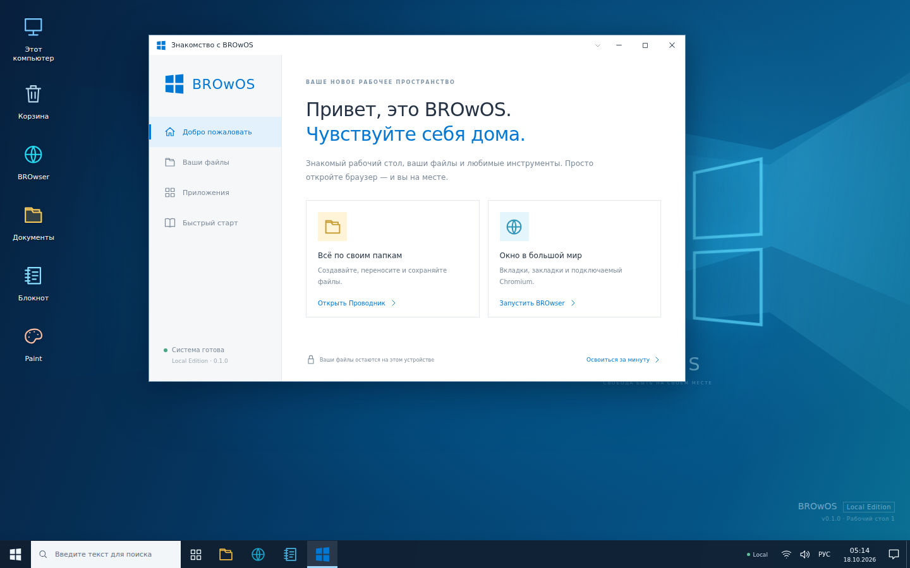
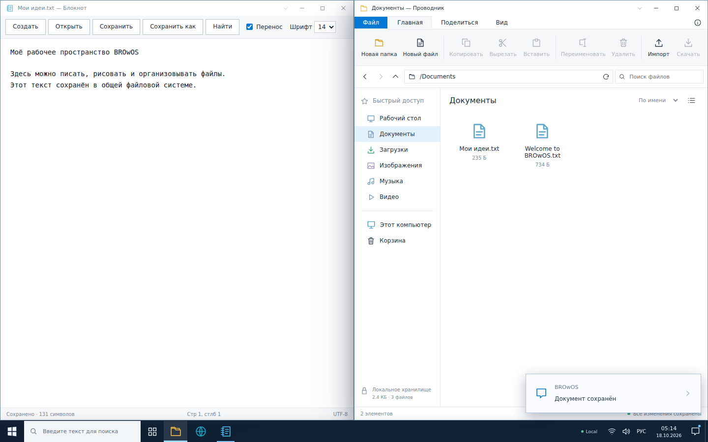

<p align="center"></p>

# BROwOS

**Рабочий стол, файлы и приложения — в обычном браузере.**

BROwOS — самостоятельная браузерная операционная среда с интерфейсом,
вдохновлённым Windows 10. Здесь можно открывать несколько окон, организовывать
файлы, писать заметки, рисовать, слушать собственную музыку и использовать
встроенный браузер. Файлы действительно сохраняются в IndexedDB между сеансами.
Отдельный Connected-сервер предоставляет настоящий Chromium с удалённым вводом.

**Версия исходников: 0.1.0, preview.** Основной репозиторий:
[romantic52/BROwOS](https://github.com/romantic52/BROwOS). BROwOS не является
продуктом Microsoft и не устанавливает Windows на устройство.

**Текущая доставка:** версия **0.1.0 preview** объединена в `main` через PR
[#7](https://github.com/romantic52/BROwOS/pull/7); проверенный commit основной ветки — [afa791f](https://github.com/romantic52/BROwOS/commit/afa791f7b6ee335dcfed5363f7f46e090575525e).
[CI #39100264368](https://github.com/romantic52/BROwOS/actions/runs/39100264368) успешно завершился на Node 22/24, включая серверный Chromium и frontend E2E;
артефакты сборки и браузерных проверок доступны в run. GitHub Release/tag не
создавались. GitHub Pages пока не опубликован: проверка целевого адреса вернула HTTP 404.

**English:** BROwOS is a Windows 10-inspired browser desktop with persistent
virtual files, multitasking and integrated applications. Local mode runs as a
static web app; the optional authenticated Connected service runs real Chromium
on your own server. This preview does not include a Windows virtual machine.

## Быстрый запуск

Нужны Git, **Node.js 22.12+** и **pnpm 10.34.7**. CI настроен на Node 22 и 24.
Версии и команды закреплены в [package.json](package.json) и
[pnpm-lock.yaml](pnpm-lock.yaml).

```sh
git clone https://github.com/romantic52/BROwOS.git
cd BROwOS
corepack enable
corepack prepare pnpm@10.34.7 --activate
pnpm install --frozen-lockfile
pnpm dev
```

Откройте [http://localhost:5173](http://localhost:5173). Для Local-режима не нужны
серверный токен, платный хостинг или дополнительные учётные записи. Если в вашей
установке Node нет Corepack, установите закреплённый pnpm командой
`npm install --global pnpm@10.34.7` и продолжите с установки зависимостей.

Для production-сборки и её локальной проверки:

```sh
pnpm build
pnpm preview
```

Preview доступен по адресу [http://localhost:4173](http://localhost:4173).
Собранный frontend находится в `apps/web/dist`, backend — в `apps/server/dist`.
Открывайте приложение через HTTP-сервер, а не двойным щелчком по `index.html`.

## Что уже можно делать

- Открывать приложения из Пуска, искать приложения и файлы, работать с панелью
  задач, уведомлениями, календарём и двумя виртуальными рабочими столами.
- Перемещать окна, менять их размеры, сворачивать, разворачивать, закреплять
  слева/справа и восстанавливать положение после перезагрузки страницы.
- Создавать папки и файлы, копировать и перемещать деревья каталогов, импортировать
  собственные файлы, скачивать их обратно, пользоваться Корзиной и резервными копиями.
- Открывать один и тот же файл в системных приложениях через общую файловую систему.
- Сохранять текст в Блокноте и PNG из Paint; просматривать изображения,
  воспроизводить поддерживаемые браузером аудио- и видеофайлы.
- Управлять виртуальными файлами из терминала и запускать приложения командами.
- Использовать вкладки и закладки BROwser; подключать собственный Chromium-сервер.

### Приложения

| Приложение          | Реализованные функции                                                                                                                                                         |
| ------------------- | ----------------------------------------------------------------------------------------------------------------------------------------------------------------------------- |
| **Проводник**       | Папки, адресная строка и история, список/плитки, сортировка, поиск, множественный выбор, copy/cut/paste, rename, импорт файлов перетаскиванием, скачивание, свойства, Корзина |
| **Блокнот**         | Создание и открытие текста, сохранение/«Сохранить как», поиск, перенос строк, положение курсора, защита несохранённых изменений, проверка конфликтующего сохранения           |
| **Калькулятор**     | Вычисление выражений с приоритетом операций, скобки, десятичные числа, проверка ошибок; выражения разбираются собственным парсером                                            |
| **Paint**           | Кисть, ластик, линия, прямоугольник, эллипс, цвет и толщина, undo/redo, открытие изображения и сохранение PNG в общую VFS                                                     |
| **Фотографии**      | Открытие изображений из VFS, масштаб, поворот, переход между изображениями                                                                                                    |
| **Медиаплеер**      | Аудио/видео из VFS, воспроизведение, пауза, перемотка, громкость, скорость, переход между файлами                                                                             |
| **Терминал**        | `ls`, `cd`, `pwd`, `cat`, `mkdir`, `touch`, `write`, `append`, `cp`, `mv`, `rename`, `rm`, `trash`, `restore`, `open` и справка `help`                                        |
| **Параметры**       | Светлая/тёмная тема, четыре фона, акцент, имя, часы, восстановление окон, уменьшение анимации, использование хранилища, экспорт/импорт резервной копии                        |
| **Диспетчер задач** | Список открытых приложений BROwOS, их время работы, закрытие окна, реальное число файлов и логический объём VFS                                                               |
| **BROwser**         | Локальные вкладки, адреса, история и закладки; отдельный Connected-режим с серверным Chromium                                                                                 |

Полный перечень содержит
[реестр приложений](packages/application-runtime/src/index.ts). Диспетчер задач
показывает приложения BROwOS; он не измеряет процессы и CPU установленной Windows.

### Первые пять минут

1. Откройте **Блокнот**, напишите заметку и сохраните её в **Документы**.
2. Найдите файл в **Проводнике**, переименуйте и откройте снова. Перезагрузите
   страницу и проверьте сохранённый текст.
3. В **Paint** нарисуйте несколько линий, сохраните PNG, затем откройте его в
   **Фотографиях**.
4. Откройте **Терминал** и выполните команды ниже. Созданный текст появится в той
   же папке, которую видит Проводник.
5. В **Параметры → Хранилище** экспортируйте резервную копию.

```text
mkdir "Мой проект"
cd "Мой проект"
write notes.txt "Привет из BROwOS!\nФайл создан терминалом."
open notes.txt
```

Терминал работает с виртуальной системой BROwOS. Команды хостовой ОС, `npm`,
`bash`, PowerShell и запуск исполняемых файлов в нём отсутствуют.

## Local / Connected / Remote VM

| Возможность                           | Local                                   | Connected                                                          | Remote VM                              |
| ------------------------------------- | --------------------------------------- | ------------------------------------------------------------------ | -------------------------------------- |
| Рабочий стол и окна                   | Реализовано                             | Тот же frontend                                                    | Не реализовано                         |
| Постоянные локальные файлы            | IndexedDB текущего браузера             | Та же локальная VFS; файлы не отправляются на сервер автоматически | Не реализовано                         |
| Блокнот, Paint и остальные приложения | Реализовано                             | Работают локально                                                  | Не реализовано                         |
| Веб-страницы внутри окна              | Iframe, если сайт разрешает встраивание | Настоящий Chromium на вашем сервере                                | Не реализовано                         |
| Ввод в удалённую страницу             | —                                       | Мышь, клавиатура, текст, прокрутка, изменение viewport             | Не реализовано                         |
| Сервер                                | Не требуется                            | Нужен отдельный сервер и закрытый токен                            | Внешняя VM и её адаптер ещё не созданы |
| Установка Windows-программ / `.exe`   | Нет                                     | Нет                                                                | Не реализовано                         |
| Публикация только на GitHub Pages     | Поддерживается архитектурой             | Backend размещается отдельно                                       | Нет                                    |

Сайты могут запрещать iframe через свои заголовки. BROwser показывает ограничение
и предоставляет открытие во внешнем браузере; Local не обходит политику сайта.
Connected исполняет страницу в серверном Chromium и передаёт JPEG-кадры.
В preview нет передачи звука, загрузок/выгрузок файлов, дополнительных окон,
WebSockets и service workers серверного браузера.

Подключение и точный HTTP API: [Connected Edition](docs/CONNECTED.md).

## Скриншоты

Снимки ниже сняты с production-сборки настоящим Chrome 151.0.7922.34 в успешном
прогоне 13 E2E-сценариев. Источник сценария:
[screenshots.spec.ts](tests/e2e/screenshots.spec.ts).

**Рабочий стол и первое знакомство с BROwOS.**



**Блокнот и Проводник работают с одним сохранённым документом.** Окна закреплены
по половинам экрана; файл `Мои идеи.txt` действительно записан в общую VFS.



## Архитектура

BROwOS — pnpm-монорепозиторий. React-оболочка предоставляет приложениям общие
`DesktopServices`, Window Manager управляет состоянием окон, а VFS выполняет
изменения файлов в транзакциях IndexedDB. Настройки и проверяемое описание сеанса
окон сохраняются отдельно в localStorage. Connected API использует отдельные
контексты Chromium и фильтрующий egress-прокси.

| Каталог                          | Назначение                                                      |
| -------------------------------- | --------------------------------------------------------------- |
| `apps/web`                       | Vite frontend, оболочка, оконная рамка и общие файловые диалоги |
| `apps/server`                    | Авторизованный Chromium API и egress-прокси                     |
| `packages/kernel`                | Настройки и системные типы                                      |
| `packages/filesystem`            | Транзакционная VFS, Blob-содержимое, Корзина, резервные копии   |
| `packages/window-manager`        | Reducer окон, фокус, геометрия и восстановление сеанса          |
| `packages/application-runtime`   | Реестр приложений и ассоциации типов файлов                     |
| `packages/sdk`                   | Контракты `AppProps`, `AppManifest`, `DesktopServices`          |
| `packages/ui`, `packages/shared` | Общие иконки, функции форматирования и нормализации             |
| `system-apps`                    | Исходники встроенных приложений                                 |
| `tests`, `.github/workflows`     | Поведенческие тесты, CI, E2E и публикация                       |
| `docker`, `docs`                 | Connected-развёртывание и инженерная документация               |

Подробности: [ARCHITECTURE.md](ARCHITECTURE.md), [SDK](docs/SDK.md),
[документация VFS](packages/filesystem/README.md).

### Технологии

React 19.3.1, TypeScript 5.9, Vite 8.3.4, pnpm 10.34.7, IndexedDB, Canvas,
HTMLMediaElement, Node HTTP, Playwright 1.62.1 и Vitest 5.0.5. Backend не зависит
от SaaS-браузера или платного API. Точные зависимости и разрешённые диапазоны
смотрите в workspace-манифестах и lockfile.

## Проверки и разработка

```sh
pnpm format:check
pnpm lint
pnpm typecheck
pnpm test:unit
pnpm test:integration
pnpm build
pnpm audit:dependencies
```

`pnpm check` объединяет форматирование, lint, typecheck, unit/integration и
сборку. Аудит и E2E запускаются отдельно. Для браузерных проверок установите
Chromium и запустите `pnpm test:e2e`; подробные команды и ограничения исполнителя
описаны в [docs/TESTING.md](docs/TESTING.md).

После последних изменений browser полный локальный Vitest-прогон завершился
**210/210 passed, 0 failed, 0 skipped** в 13 файлах. В общий итог входят 29 тестов
browser client, 4 интеграции файлов с приложениями и 64 серверных теста, включая
3 проверки с настоящим Chromium. Отдельно **13/13 frontend E2E** прошли на свежей
production-сборке за **18,3 секунды**, без ошибок и пропусков. Общий production
build, ESLint и TypeScript check также прошли.

В GitHub успешно завершился [CI #39100264368](https://github.com/romantic52/BROwOS/actions/runs/39100264368): quality checks на **Node 22 и 24**,
**64 серверных теста** и **13 frontend E2E за 24,6 с**. Run содержит artifacts
`web-dist-…` и `browser-evidence-…`. Повторный [CI main #39100459559](https://github.com/romantic52/BROwOS/actions/runs/39100459559) после merge также завершился **success**;
для `afa791f` сохранены artifacts `web-dist-…` и `browser-evidence-…`. Публикация Pages отдельно не подтверждена; точные границы
проверок и доставки записаны в [DEVELOPMENT_STATUS.md](docs/DEVELOPMENT_STATUS.md).

Сообщения коммитов используют Conventional Commits. Порядок работы,
критерии проверки и правила сохранения данных — в
[CONTRIBUTING.md](CONTRIBUTING.md), [SECURITY.md](SECURITY.md) и
[шаблоне PR](.github/PULL_REQUEST_TEMPLATE.md). Открытая лицензия для кода BROwOS
владельцем пока не выбрана; сторонние зависимости сохраняют собственные лицензии.

## Развёртывание

### Frontend Demo

Workflow GitHub Pages публикует frontend из успешного CI/E2E для актуального
`main`. **Целевой адрес:** `https://romantic52.github.io/BROwOS/`.
Последняя HTTP-проверка вернула **404**. [Deploy Pages #39100560196](https://github.com/romantic52/BROwOS/actions/runs/39100560196) завершился **failed**
на шаге `Read existing Pages configuration` (`configure-pages`):
`Get Pages site failed`, `HttpError: Not Found`. Проверки кода в CI прошли;
публикация заблокирована конфигурацией Pages.
Следующий шаг — **Settings → Pages → Source → GitHub Actions**, затем повторить
неудавшийся Deploy для того же актуального SHA `main`. Если `main` изменится,
нужно дождаться CI новой версии и запустить публикацию её проверенного artifact.
После deployment проверить загрузку приложения.
В текущем сеансе GitHub connector не предоставил административные endpoints Pages,
а доступ к настройкам через cloud browser остановился на timeout. Готовые workflows
уже находятся в `main`; работа отслеживается в [Issue #5](https://github.com/romantic52/BROwOS/issues/5).

### Full Connected Edition

Подготовлены Dockerfile для frontend/backend и
[docker-compose.yml](docker-compose.yml). Нужны собственный Docker-хост с
поддержкой Chromium sandbox, приватные токены и HTTPS для удалённого доступа.
GitHub Pages не запускает этот backend. Docker daemon отсутствовал в рабочем
окружении разработки, поэтому успешный запуск контейнеров пока не подтверждён.
Публичный HTTPS smoke также требует проверки на целевом хосте: здесь системный
DNS не разрешил внешний тестовый домен.

Инструкции обоих вариантов: [docs/DEPLOYMENT.md](docs/DEPLOYMENT.md).

## Данные и текущие границы

Файлы принадлежат профилю браузера и origin сайта. Очистка данных сайта, приватный
режим или удаление браузером хранилища могут удалить VFS. Смена домена, протокола
или порта создаёт другое пространство хранения. Делайте экспорт важных данных;
импорт резервной копии добавляет проверенные копии, сохраняя существующие файлы.

Восстановление сеанса возвращает окна и ссылки на сохранённые файлы. Несохранённый
текст, холст, серверные cookies и пароли не считаются сохранённым сеансом.
Экран блокировки — элемент интерфейса, не система аутентификации.

Preview не включает синхронизацию между устройствами, прямое монтирование дисков
компьютера, магазин сторонних приложений, безопасную песочницу для произвольных
плагинов, виртуализацию процессора или совместимость с Windows API. Эти границы
отражены в [ROADMAP.md](ROADMAP.md), а выполненная работа — в
[CHANGELOG.md](CHANGELOG.md).
